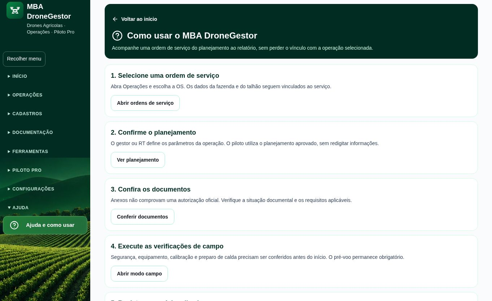
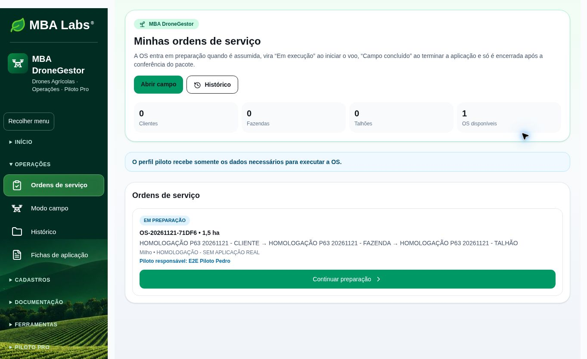

# DroneGestor — revisão e homologação de navegação — 22/11/2026

## Estado consolidado — continuação em 23/11/2026

**Homologação parcial. PR #206 permanece em rascunho, sem merge e sem produção.** As demais seções registram a evolução cronológica; resultados antigos não substituem este estado atual.

- Código atual: `9c3fee6cda33b000b4ce3099671e49afb3ff2449`. Prévia `dpl_FUMRvhyJdF6NHNp7uU9oEL6Dtibx` READY, target preview (`null`), confirmado novamente nesta continuação.
- **188 testes locais aprovados, zero reprovados, zero ignorados**, conforme `evidencias/dronegestor-20261123-os-somente-consulta/testes.txt`, com XLSX original MAPA. TypeScript e build aprovados, lint do escopo sem erros; lint global mantém três falhas anteriores fora do DroneGestor.
- CI do código atual: [DroneGestor validation 28](https://github.com/mauriciobarrosaguiar/mbalabs/actions/runs/45111408992) e [MBA Labs Core CI 776](https://github.com/mauriciobarrosaguiar/mbalabs/actions/runs/45111409048), ambos success, reconfirmados nesta continuação.
- Interface: RT criou cliente/fazenda/talhão/OS fictícios, vinculou Pedro e salvou planejamento. Pedro recebeu os parâmetros, preparou a OS, preservou fase/contexto e retornou da documentação à fase 2. Consulta direta da OS de outro piloto negada pela API na sessão do Pedro.
- Nova **OS-20261123-45737**, 0,1 ha, em preparação e sem aplicação, identifica HOMOLOGAÇÃO PR206. A OS anterior do Pedro foi preservada. Um anexo categoria outro, SEM VALIDADE OFICIAL, foi enviado e baixado com bytes idênticos.
- Calculadoras testadas pela interface: calda, adicionar/remover produto e bloquear produto incompleto, vazão, rendimento e custos, nos cenários fictícios documentados.
- Somente automatizado: transições de execução, encerramento parcial/complementação, concorrência/sincronização entre aparelhos, geração de XLSX original e PDF final.
- Bloqueado: confirmações físicas/regulatórias; seis resoluções exatas/teclado virtual no navegador anterior; PDF embutido bloqueado pelo Chromium (download aprovado). RLS produtiva não foi alterada ou homologada por estas guardas.
- Ainda não executado integralmente: cada botão/modal/estado, escritas remotas negativas em todos os perfis e exportação MAPA pela interface com operação final revisada.

Prévia: https://mbalabs-git-fix-dronegesto-d7a9dd-emsgenericosto-3419s-projects.vercel.app/apps/dronegestor

### Reteste observado antes da interrupção do ambiente

|Módulo|Ação|Perfil|Destino esperado|Resultado|Evidência|
|---|---|---|---|---|---|
|MAPA|URL direta relatorio-mensal|Pedro|Minhas ordens de serviço|Aprovado pela interface|Observação registrada na conversa desta execução: URL final /gestao e título Minhas ordens de serviço|
|Menu Documentação|Abrir grupo|Pedro|Sem link gerencial MAPA|Aprovado pela interface|Observação registrada na conversa: Documentos, Diagnóstico, Legislação|
|Pacote|Consultar OS fictícia|Pedro|Preparação e 0,00 ha realizados|Aprovado pela interface|Observação registrada na conversa: Em preparação — aplicação não iniciada; 0,00 de 0,10 ha|
|Pacote|PDF antes da conclusão/sincronização|Pedro|Desabilitado com explicação|Aprovado pela interface|Botão PDF aguarda conclusão e sincronização do campo, disabled=true, observado na conversa|
|Pacote|Atalho Relatório MAPA|Pedro|Ausente|Aprovado pela interface|Contagem zero de links observada na conversa|

A manutenção do ambiente removeu a captura JPEG e o JSON desse último reteste antes do envio ao GitHub. Não são apresentados como arquivos anexados. As observações acima correspondem ao resultado efetivamente exibido pelas ferramentas na conversa, não a uma nova execução ou captura. Evidências das rodadas anteriores, testes e escritas já enviadas estão preservadas no repositório. A sessão do navegador foi encerrada; novos testes autenticados exigem login seguro novamente.

Sem migrations, novo projeto/banco/plano pago, dados reais alterados, liberação de voo ou envio oficial.

---

## Situação do aceite

**Homologação funcional completa pendente. Não aprovar merge nem produção com base nesta execução.**

PR #206 aberta em rascunho. Revisão iniciada no head `c0966a5bc4cadb2c094bb63c321c01790f326b48`, base `356ab708584a45c6ba633241ce035e2c0908fc0a`. Fetch confirmou esses refs antes da entrega. Os workflows desse head estavam concluídos com sucesso: [DroneGestor validation](https://github.com/mauriciobarrosaguiar/mbalabs/actions/runs/45057405900) e [MBA Labs Core CI](https://github.com/mauriciobarrosaguiar/mbalabs/actions/runs/45057405884). Esses resultados não validam automaticamente o commit adicional desta revisão.

Os 13 arquivos do diff original foram revisados: shell, dashboard, Ajuda, Cadastros, Campo V3, próxima ação, oito fases, Documentos, gestão de OS, painel do gestor, página de gestão, testes de navegação e relatório anterior. Novas correções abaixo ampliam apenas o DroneGestor e seus testes/documentação. Nenhum outro aplicativo foi alterado.

## Correções implementadas nesta revisão

1. Troca de OS protege execução pausada mesmo com `started=false`, hectares/cargas órfãos, identificador de operação e fila de finalização offline. Estado ilegível bloqueia a troca. A proteção é executada antes da atribuição automática no modo solo. A mesma OS continua consultável; esta regra não autoriza voo.
2. Abertura de OS tem trava contra chamadas simultâneas. Status `em_preparacao` recebe a mesma ação de preparação. OS cancelada passa a ter acesso ao pacote para consulta.
3. Consulta do pacote não grava a missão consultada sobre a missão ativa do aparelho. Fechar uma OS diferente não finaliza o estado local de outra operação. Salvar dados cadastrais no pacote também não substitui esse checkpoint.
4. API de regularização da propriedade recusa alteração de OS cancelada e concluída (409); pacote esconde ações de escrita e desabilita os campos nesses estados. Testes executam o handler real com dependências isoladas, verificando zero escritas e bloqueio de piloto/outra empresa.
5. Checklist SARPAS/documental recebe a OS selecionada no painel de Documentos e busca o snapshot autorizado dessa OS. Deixa de usar a missão local para escolher a OS. Erro de consulta esvazia o contexto de escrita, em vez de apresentar dados antigos como válidos. A guarda agrícola permanece no Campo; a página documental não modifica silenciosamente a missão local.
6. Fase 3 permanece documental externa, mas links do Campo sinalizam a origem e oferecem retorno à etapa persistida somente quando a OS local coincide com a selecionada. Visitar a página não marca documentação concluída, não emite autorização nem altera banco para registrar uma fase.
7. Retorno do planejamento/pacote conserva `tab=os&osId`. Mudanças de query atualizam as abas; o pacote remonta seus painéis quando muda o `osId`. Um piloto não ganha uma aba administrativa por informar `tab=cliente` na URL.
8. Ajuda evita atalhos de Cadastros/Conferência administrativa para piloto. Autorizações de servidor existentes continuam necessárias.
9. Suíte visual antiga tinha nomes AgroDoc, expectativas de interface anterior e resoluções incompletas. Foi atualizada para navegar pelos links reais dos menus e contemplar as seis resoluções, usando sessão específica fornecida ao executor; não cria dados remotos.
10. Corrigido erro de lint no harness de sincronização (nome de variável local); nenhuma regra de segurança/lint foi desligada.

## Validação executada

- Testes DroneGestor: **148 aprovados, 0 reprovados, 0 ignorados**. Inclui nove novas regressões de navegação/contexto e dois testes da API do pacote.
- O XLSX original de referência foi recuperado e usado pelo teste isolado do exportador. O teste verifica preservação das partes do arquivo, fórmulas e recursos das abas; não envia nada ao MAPA. Isso é aprovação automatizada, não exportação pela interface.
- TypeScript e build de produção: ver evidências anexas desta revisão. O build local não publica a aplicação.
- Lint restrito ao DroneGestor: sem erros; avisos preexistentes de dependências de hooks, imagens e variáveis constam no log.
- Lint geral: reprovado por problemas preexistentes em `elshaday/biblia/BibleReader.tsx`, `elshaday/eventos/page.tsx` e `tests/cotacoes-admin-routing.test.mjs`. Os arquivos não foram modificados por esta missão. Não declarar lint geral aprovado.
- Suíte visual: **6 testes ignorados/bloqueados**, por ausência de URL da prévia e sessão específica no executor. Nenhuma captura de seis resoluções foi produzida. Ignorado não equivale a aprovado.
- Navegador real: sessão Pulveriza 63 já existente em produção. Acessados Início e o menu Operações; destino `/apps/dronegestor/gestao`, título Operações e item ativo conferidos. A página ainda contém o wrapper anterior e os dois registros fictícios. Esta observação é baseline da produção, **não aceite da PR #206**. Login e planejamento de Pedro não foram repetidos.

## Evidências

Arquivos em [evidencias/dronegestor-20261122](evidencias/dronegestor-20261122/): saída dos testes, build, TypeScript, lint geral/restrito, skip visual e registro textual da observação real. Os testes de autorização usam fixtures isoladas, não sessões humanas de piloto/RT. Não há capturas simuladas ou captura de produção atribuída à prévia.

## Matriz de módulos e ações

| Módulo | Botão/ação | Perfil | Destino esperado | Resultado | Evidência |
|---|---|---|---|---|---|
| Produção (baseline) | Menu Operações | Sessão Pulveriza 63 existente | `/gestao`, título Operações, menu ativo | Aprovado pela interface **somente no baseline publicado** | `interface-baseline.md` |
| Gestão | Trocar OS com execução pausada/área/cargas/fila | Estado local controlado | Bloquear sem descartar progresso | Aprovado somente por teste automatizado | `dronegestor-navigation-runtime.test.mjs` |
| Gestão | Voltar à mesma OS ou trocar após finalização | Estado local controlado | Preservar checkpoint / permitir nova seleção consistente | Aprovado somente por teste automatizado | Mesmo teste |
| Documentos | Selecionar OS e carregar checklist técnico | Fixture/análise de integração | Usar `osId` selecionado, sem escolher missão local | Aprovado somente por teste automatizado (regressão estática) | Mesmo teste |
| Campo | Fase 3 e retornar | Piloto/gestor/RT reais | Mesma OS e etapa persistida | Bloqueado | Prévia autenticada indisponível |
| Pacote | Consultar outra OS | Análise de integração | Não sobrescrever missão ativa | Aprovado somente por teste automatizado (regressão estática) | Mesmo teste |
| Pacote/API | Editar propriedade de OS cancelada/concluída | RT em fixture isolada | HTTP 409 e zero escritas | Aprovado somente por teste automatizado | `dronegestor-dossier-access.test.mjs` |
| Pacote/API | Editar dados sem perfil / empresa alheia | Piloto/RT em fixtures separadas | 403/404 e zero escritas | Aprovado somente por teste automatizado | Mesmo teste |
| Navegação | Rotas dos menus e preservação de `osId` | Análise de código | Rota existente, parâmetro mantido | Aprovado somente por teste automatizado (estático) | `dronegestor-navigation.test.mjs` |
| Planejamento | Salvar, permissões e conflito | Fixtures de piloto, RT e gestor | Rejeitar perfis/estado/versão indevidos | Aprovado somente por teste automatizado | `dronegestor-planning.test.mjs` |
| Execução parcial | Encerrar parcialmente, complementar, retry | Fixtures controladas | Manter área/cargas cumulativas, impedir duplicação | Aprovado somente por teste automatizado | `dronegestor-partial-api.test.mjs` |
| Sincronização | Edição durante upload, troca de conta, conflitos | Aparelho/rede em harness | Não confirmar edição posterior nem sobrescrever outra conta | Aprovado somente por teste automatizado | `dronegestor-sync.integration.test.mjs`, testes CAS/guard |
| RLS | Regras isoladas de acesso | Banco de testes local | Isolamento conforme suíte | Aprovado somente por teste automatizado | `dronegestor-rls.test.mjs` |
| RLS real | Conferir políticas e aplicar correções | Supabase produtivo | Segurança efetiva | Bloqueado | Sem migrations, sem consulta de credenciais do banco; pendência anterior de `core_logs` não resolvida |
| MAPA | Preencher XLSX original, estrutura/fórmulas | RT em fixture isolada | Exportador preservar modelo | Aprovado somente por teste automatizado | `dronegestor-mapa-original.test.mjs` |
| MAPA | Competência, gerar, exportar e baixar pela UI | RT real | Arquivo real autorizado da competência | Bloqueado | Prévia e sessão RT ausentes |
| Formulários | Criar cliente/fazenda/talhão/drone/piloto/OS | Gestor/administrador | Persistência, feedback e impedir envio duplicado | Não executado pela interface | Sem escrita em banco remoto nesta execução |
| Campo | Medições físicas, GPS, SARPAS e liberar/retomar | Piloto real | Evidências legítimas e pré-voo válido | Bloqueado | Não simular confirmações regulatórias/físicas |
| Segurança | Leitura/atualização/execução por sessões reais distintas | Piloto, gestor, RT | Negar URL/API fora da autorização | Bloqueado | Só havia sessão da empresa em produção; fixtures não substituem essas sessões |

### Aceite dos menus da PR (não confundir com teste estático de rotas)

Cada linha exige clique, título/conteúdo, retorno, item ativo e menu mobile. Todos dependem de prévia da branch; nenhuma dessas linhas está homologada visualmente nesta revisão.

| Módulo | Botão/ação | Perfil | Destino esperado | Resultado | Evidência |
|---|---|---|---|---|---|
| Início | Dashboard | Todos | `/apps/dronegestor` | Bloqueado | Sem prévia autenticada da branch |
| Operações | Ordens de serviço | Todos | `/apps/dronegestor/gestao` | Bloqueado | Sem prévia autenticada da branch |
| Operações | Modo Campo | Piloto/gestor autorizado | `/apps/dronegestor/campo` | Bloqueado | Sem prévia autenticada da branch |
| Operações | Histórico | Todos | `/apps/dronegestor/historico` | Bloqueado | Sem prévia autenticada da branch |
| Operações | Fichas | Todos | `/apps/dronegestor/fichas` | Bloqueado | Sem prévia autenticada da branch |
| Operações | Conferência | Gestor/RT | `/apps/dronegestor/conferencia` | Bloqueado | Sem prévia autenticada da branch |
| Cadastros | Visão dos cadastros | Gestor/RT | `/apps/dronegestor/cadastros` | Bloqueado | Sem prévia autenticada da branch |
| Cadastros | Drones e equipamentos | Conforme acesso | `/apps/dronegestor/equipamentos` | Bloqueado | Sem prévia autenticada da branch |
| Cadastros | Pilotos | Gestor/RT | `/apps/dronegestor/pilotos` | Bloqueado | Sem prévia autenticada da branch |
| Cadastros | Minha equipe | Gestor/RT | `/apps/dronegestor/equipe` | Bloqueado | Sem prévia autenticada da branch |
| Cadastros | Funcionários e acessos | Admin empresa | `/apps/dronegestor/funcionarios` | Bloqueado | Sem prévia autenticada da branch |
| Documentação | Documentos | Conforme OS | `/apps/dronegestor/documentos` | Bloqueado | Sem prévia autenticada da branch |
| Documentação | Diagnóstico | Todos | `/apps/dronegestor/diagnostico` | Bloqueado | Sem prévia autenticada da branch |
| Documentação | Legislação | Todos | `/apps/dronegestor/regulacao` | Bloqueado | Sem prévia autenticada da branch |
| Documentação | Relatórios MAPA | Conforme permissão | `/apps/dronegestor/relatorio-mensal` | Bloqueado | Sem prévia autenticada da branch |
| Ferramentas | MBA Calda | Todos | `/apps/dronegestor/ferramentas` | Bloqueado | Sem prévia autenticada da branch |
| Ferramentas | Defensivos/AGROFIT | Todos | `/apps/dronegestor/produtos` | Bloqueado | Sem prévia autenticada da branch |
| Piloto Pro | Biblioteca | Todos | `/apps/dronegestor/piloto-pro` | Bloqueado | Sem prévia autenticada da branch |
| Configurações | Perfil operacional | Todos | `/apps/dronegestor/perfil-operacional` | Bloqueado | Sem prévia autenticada da branch |
| Configurações | Configurações | Gestor/RT | `/apps/dronegestor/configuracoes` | Bloqueado | Sem prévia autenticada da branch |
| Configurações | Administração | Admin sistema | `/apps/dronegestor/administracao` | Bloqueado | Sem prévia autenticada da branch |
| Ajuda | Como utilizar | Todos | `/apps/dronegestor/ajuda` | Bloqueado | Sem prévia autenticada da branch |

### Oito fases e retomada

| Fase/cenário | O que está coberto | Classificação do aceite funcional |
|---|---|---|
| 1 — OS | Dados e seleção revisados; proteção de contexto testada | Bloqueado pela interface da PR |
| 2 — Planejamento | API/versão/perfis cobertos por fixtures | Aprovado somente por teste automatizado; interface bloqueada |
| 3 — Documentação | Integração externa consistente, selecionada por OS, retorno ao Campo | Aprovado somente por teste automatizado estático; interface bloqueada |
| 4 — Segurança real | Bloqueios existentes preservados | Bloqueado por medições e inspeções legítimas |
| 5 — Equipamento/calibração | Guardas e sequência revisadas | Bloqueado por inspeção física; testes não atestam equipamento |
| 6 — Calda | Cálculos da suíte executados | Aprovado somente por teste automatizado; interação bloqueada |
| 7 — Aplicação | Pré-voo não enfraquecido; encerramento parcial/retry testados isoladamente | Aprovado somente por teste automatizado; execução real bloqueada |
| 8 — Pós-operação | Consulta segura do pacote e API de propriedade protegida | Aprovado somente por teste automatizado; interface bloqueada |
| Mesmo aparelho: pausar, fechar, reabrir | Guardas/armazenamento em testes controlados | Não executado ponta a ponta no navegador |
| Outro aparelho | Abertura sem checkpoint permanece conservadoramente bloqueada | Bloqueado; não afirmar retomada multiaparelho aprovada |
| Sem internet/reconexão | Retry/idempotência/CAS em testes | Aprovado somente por teste automatizado; browser offline não executado |

Avançar/Voltar/Retomar nas oito fases, retornos externos, seleção preservada e persistência devem ser conferidos na prévia com dados autorizados. Navegação não marca fase como concluída.

### Mobile

| Resolução | Menus, botões, formulário, scroll, modais e mapas | Captura real |
|---|---|---|
| 360 × 800 | Bloqueado | Não produzida |
| 390 × 844 | Bloqueado | Não produzida |
| 768 × 1024 | Bloqueado | Não produzida |
| 1024 × 768 | Bloqueado | Não produzida |
| 1440 × 900 | Bloqueado | Não produzida |
| 1920 × 1080 | Bloqueado | Não produzida |

A suíte preparada não homologa teclado virtual de um aparelho físico. Testar separadamente datas/números/teclado, upload/visualização/download, botões de escrita, permissões por sessão, notificações e transições operacionais.

## Prévia e continuação necessária

**Prévia agora disponível e autenticada:** https://mbalabs-fpglt10xe-emsgenericosto-3419s-projects.vercel.app/apps/dronegestor

Deploy `dpl_AheVcPLkkiRwpd3iV4jvsDjmmmN9`, estado READY, `target=null` (preview), commit `b110d737ab24e4254f0532b3a24ba1174ee0add6`. Projeto Vercel existente `mbalabs`; nenhuma promoção de domínio produtivo. Proteção Vercel mantida; o próprio usuário realizou a entrada segura pela Vercel e MBA Labs. Os workflows consultados são de validação; não fornecer a URL produtiva como se fosse prévia.

O usuário confirmou o workspace MBALabs. A consulta mostrou que a Render hospeda MBA Sites/Evolution API, não este repositório. O projeto correto foi localizado na Vercel. A prévia foi criada no projeto já existente sem mudança de plano, nova base ou contratação. Não foi apurado um valor de consumo faturável da conta; não afirmar custo de uso igual a zero. A branch fix/* continua sem deploy automático; a criação desta prévia foi explícita.

Depois de existir uma prévia configurada, reutilizar sessão legítima ou solicitar login direto no navegador seguro, separadamente para piloto, gestor e RT. Não solicitar senhas no chat nem copiá-las/armazená-las. Não repetir login/planejamento de Pedro já aprovados sem necessidade. Manter testes de escrita em fixtures ou registros de teste autorizados e isolados.

## Riscos e restrições mantidos

- Nenhuma migration, alteração de dados reais, conta/banco Supabase novo, contratação, voo ou envio regulatório foi realizado.
- Não houve merge nem deploy produtivo. A PR permanece rascunho.
- Não declarar as oito fases integralmente homologadas, RLS produtiva aprovada, troca de aparelho recuperada ou mobile aprovado.
- Mudanças no contexto documental/pacote precisam de validação visual adicional; por isso a recomendação continua sendo reter a aprovação operacional.
- O lint geral ainda impede declarar todos os checks solicitados aprovados; os três arquivos externos ao DroneGestor precisam de uma correção em escopo próprio.

## Continuação — prévia real autenticada

Esta seção atualiza os bloqueios anteriores de acesso à prévia; as classificações de API/execução/mobile permanecem separadas.

- Ambos os workflows do commit `b110d73` foram concluídos com **success** (Core CI 764 e DroneGestor validation 22). O teste local com XLSX original continua sendo evidência separada do CI.
- A conta informada pelo titular apresentou acesso administrativo, inclusive Administração do sistema e Funcionários. Não atribuir estes resultados a uma sessão de piloto ou RT.
- **20 destinos do menu lateral clicados**, com URL e título H1 observados, um item ativo e retorno do navegador ao início. Além disso, a página inicial foi aberta e autenticada. O teste cobre navegação, não persistência ou escrita em cada módulo.
- Recolher/expandir menu, abrir/fechar pendências, buscar Ajuda, fechar busca com Escape e link Voltar ao início da Ajuda foram executados pela interface.
- Não foi testado o Modo Campo nesta conta administrativa: a página monta sincronização automática de estado, e não se presume que o banco da prévia esteja isolado da produção. Não acionar gravações remotas sem delimitar estado fictício. A OS de Pedro não foi alterada, selecionada para execução nem replanejada.
- Captura real da Ajuda produzida no viewport observado de **1363 × 936**. O arquivo é um recorte de 1363 × 836 iniciado em y=100, excluindo o cabeçalho da conta. Não foi redimensionado nem gerado por IA; não é captura de nenhuma das seis resoluções exigidas.
- A ferramenta de navegador disponível não expõe ajuste de viewport; o Chromium apresenta bloqueio organizacional de DevTools. O painel de display oferece no máximo 1364 × 1024. Não houve alteração de política ou contorno da proteção. As seis resoluções e teclado virtual continuam **bloqueados/não executados**.

### Matriz de navegação real na prévia

| Módulo | Botão/ação | Perfil | Destino esperado | Resultado | Evidência |
|---|---|---|---|---|---|
| Ordens de serviço | Clique, item ativo e voltar | Sessão administrativa informada pelo titular | `/apps/dronegestor/gestao` — H1: O que precisa da sua atenção agora | Aprovado pela interface para navegação | `previa-menu-interface.json` |
| Histórico | Clique, item ativo e voltar | Sessão administrativa informada pelo titular | `/apps/dronegestor/historico` — H1: Histórico de operações | Aprovado pela interface para navegação | `previa-menu-interface.json` |
| Fichas de aplicação | Clique, item ativo e voltar | Sessão administrativa informada pelo titular | `/apps/dronegestor/fichas` — H1: Fichas das operações | Aprovado pela interface para navegação | `previa-menu-interface.json` |
| Conferência de operações | Clique, item ativo e voltar | Sessão administrativa informada pelo titular | `/apps/dronegestor/conferencia` — H1: Conferência de operações | Aprovado pela interface para navegação | `previa-menu-interface.json` |
| Visão dos cadastros | Clique, item ativo e voltar | Sessão administrativa informada pelo titular | `/apps/dronegestor/cadastros` — H1: Cadastros | Aprovado pela interface para navegação | `previa-menu-interface.json` |
| Drones e equipamentos | Clique, item ativo e voltar | Sessão administrativa informada pelo titular | `/apps/dronegestor/equipamentos` — H1: Drones e equipamentos | Aprovado pela interface para navegação | `previa-menu-interface.json` |
| Pilotos | Clique, item ativo e voltar | Sessão administrativa informada pelo titular | `/apps/dronegestor/pilotos` — H1: Pilotos e acessos | Aprovado pela interface para navegação | `previa-menu-interface.json` |
| Minha equipe | Clique, item ativo e voltar | Sessão administrativa informada pelo titular | `/apps/dronegestor/equipe` — H1: Minha equipe | Aprovado pela interface para navegação | `previa-menu-interface.json` |
| Funcionários e acessos | Clique, item ativo e voltar | Sessão administrativa informada pelo titular | `/apps/dronegestor/funcionarios` — H1: Funcionários e acessos | Aprovado pela interface para navegação | `previa-menu-interface.json` |
| Documentos | Clique, item ativo e voltar | Sessão administrativa informada pelo titular | `/apps/dronegestor/documentos` — H1: MBA DroneGestor · Documentos | Aprovado pela interface para navegação | `previa-menu-interface.json` |
| Diagnóstico e regularização | Clique, item ativo e voltar | Sessão administrativa informada pelo titular | `/apps/dronegestor/diagnostico` — H1: Diagnóstico e regularização | Aprovado pela interface para navegação | `previa-menu-interface.json` |
| Legislação e fontes | Clique, item ativo e voltar | Sessão administrativa informada pelo titular | `/apps/dronegestor/regulacao` — H1: Legislação e fontes | Aprovado pela interface para navegação | `previa-menu-interface.json` |
| Relatórios MAPA | Clique, item ativo e voltar | Sessão administrativa informada pelo titular | `/apps/dronegestor/relatorio-mensal` — H1: Relatórios MAPA | Aprovado pela interface para navegação | `previa-menu-interface.json` |
| MBA Calda e calculadoras | Clique, item ativo e voltar | Sessão administrativa informada pelo titular | `/apps/dronegestor/ferramentas` — H1: MBA Calda | Aprovado pela interface para navegação | `previa-menu-interface.json` |
| Defensivos e AGROFIT | Clique, item ativo e voltar | Sessão administrativa informada pelo titular | `/apps/dronegestor/produtos` — H1: Defensivos e AGROFIT | Aprovado pela interface para navegação | `previa-menu-interface.json` |
| Piloto Pro | Clique, item ativo e voltar | Sessão administrativa informada pelo titular | `/apps/dronegestor/piloto-pro` — H1: Piloto Pro | Aprovado pela interface para navegação | `previa-menu-interface.json` |
| Perfil operacional | Clique, item ativo e voltar | Sessão administrativa informada pelo titular | `/apps/dronegestor/perfil-operacional` — H1: Perfil operacional | Aprovado pela interface para navegação | `previa-menu-interface.json` |
| Configurações | Clique, item ativo e voltar | Sessão administrativa informada pelo titular | `/apps/dronegestor/configuracoes` — H1: Configurações | Aprovado pela interface para navegação | `previa-menu-interface.json` |
| Administração do sistema | Clique, item ativo e voltar | Sessão administrativa informada pelo titular | `/apps/dronegestor/administracao` — H1: Administração do DroneGestor | Aprovado pela interface para navegação | `previa-menu-interface.json` |
| Ajuda e como usar | Clique, item ativo e voltar | Sessão administrativa informada pelo titular | `/apps/dronegestor/ajuda` — H1: Como usar o MBA DroneGestor | Aprovado pela interface para navegação | `previa-menu-interface.json` |

| Shell | Recolher e expandir menu | Mesma sessão | Alternar controle e menu | Aprovado pela interface | Observação browser de botões Recolher/Expandir |
| Shell | Pendências abrir/fechar | Mesma sessão | Exibir links de diagnóstico e fichas | Aprovado pela interface | Árvore de acessibilidade observada |
| Shell | Buscar Ajuda e Escape | Mesma sessão | Filtrar Ajuda e fechar pesquisa | Aprovado pela interface | Campo `ajuda`, resultado e botão Fechar pesquisa; Escape ocultou botão |
| Ajuda | Voltar ao início | Mesma sessão | `/apps/dronegestor` | Aprovado pela interface | URL após clique e H1 MBA DroneGestor |

As linhas de menus na matriz anterior que constam nesta tabela deixam de estar bloqueadas **somente quanto a clique/destino/título/item ativo/voltar em desktop nesta sessão**. Conteúdo de dados, todas as ações de negócio, diferentes perfis e mobile exigem aceites próprios; não estender esta aprovação.

## Continuação de 23/11/2026 — sessão específica de E2E Piloto Pedro

O próprio titular autenticou `e2e.piloto.pedro.dronegestor@example.invalid` pelo formulário seguro. O nome **E2E Piloto Pedro** foi confirmado na interface antes dos testes. A sessão administrativa anterior não foi usada como evidência das permissões de piloto. As contas administrativas da Pulveriza 63 e Pedro aparecem no cadastro sob a mesma denominação de empresa de testes; a OS atribuída a Pedro ficou efetivamente visível para ele, sem modificar vínculos.

Código efetivamente observado no navegador nesta rodada inicial: commit `b110d73`, prévia `mbalabs-fpglt10xe-emsgenericosto-3419s-projects.vercel.app`. Os testes abaixo são de leitura/navegação. Não houve chamada real de criação, atualização, suspensão, início ou encerramento operacional.

| Módulo | Botão/ação | Perfil | Destino esperado | Resultado | Evidência |
|---|---|---|---|---|---|
| Identidade | Login seguro | E2E Piloto Pedro | Conta de piloto, não Admin Master | Aprovado pela interface | Nome exibido; `interface-api.json` |
| OS | Consultar lista | Pedro real | Somente OS atribuídas | Aprovado pela interface e API de leitura: uma OS, `71DF6`, piloto Pedro | `interface-api.json`, captura da OS |
| Menu | Rotas de Administração, Funcionários, Conferência, Cadastros, Pilotos, Equipe e Configurações | Pedro real | Ocultas conforme perfil | Aprovado pela interface (ausentes dos links do menu) | Inventário observado |
| Administração | URL direta | Pedro real | Negar área administrativa | Aprovado pela interface: redirecionou ao início | `interface-api.json` |
| Funcionários | URL direta | Pedro real | Negar cadastro de funcionários | Aprovado pela interface: redirecionou ao início | Mesmo arquivo |
| Planejamento | URL direta da OS de Pedro | Pedro real | Negar edição de planejamento | Aprovado pela interface: redirecionou a Minhas OS | Mesmo arquivo |
| Conferência | URL direta | Pedro real | Negar página gerencial | **Reprovado na prévia anterior:** página abria; API negava os dados. Corrigido no código; reteste da nova prévia pendente | Mesmo arquivo; `dronegestor-page-access.test.mjs` |
| Cadastros | URL direta | Pedro real | Negar página gerencial | **Reprovado na prévia anterior:** página abria. Corrigido no código; reteste da nova prévia pendente | Mesmo arquivo; mesmo teste |
| APIs | Administração, empresa/usuários, planejamento e conferência por GET | Pedro real | Negar acesso administrativo | Aprovado por navegação real às APIs: JSONs de recusa, sem dados administrativos. O browser não expôs código HTTP nesta captura; não atribuir status numérico a essa evidência | `interface-api.json` |
| APIs | Criar cadastro por POST | Pedro em fixture | Recusar antes de escrever | Aprovado somente por teste automatizado: 403 e zero escritas | `dronegestor-pilot-reading.test.mjs` |
| Cadastros/API | Listar cliente/fazenda/talhão | Pedro em fixture | Apenas relações das OS atribuídas | Aprovado somente por teste automatizado; mudança nova ainda requer reteste na prévia | Mesmo teste |
| Documentos | Abrir com osId | Pedro real | Selecionar a própria OS e consultar anexos | Aprovado pela interface: OS-20261121-71DF6 e 17 anexos | `interface-api.json` |
| Documentos | Voltar à ordem de serviço | Pedro real | Retornar à mesma OS | Aprovado pela interface: `gestao?tab=os&osId=71df64e7-3148-451d-9eb6-d3001393a3f4`; cartão da mesma OS visível | Mesmo arquivo |
| Escrita operacional | Preparar/iniciar/retomar/encerrar | Pedro real | Não modificar registros reais | Não executado; nenhum desses botões foi acionado | Limite preservado |

### Correções decorrentes desta validação

- Acrescentada uma fronteira de autorização no servidor para as cinco páginas ocultas do perfil operacional: Cadastros, Conferência, Pilotos, Equipe e Configurações. A função exige acesso ao app, usuário ativo e perfil de gestão; o piloto é redirecionado às próprias OS antes de renderizar o componente administrativo.
- As listagens sanitizadas de cliente/fazenda/talhão do piloto foram limitadas às relações de suas OS atribuídas. Gestor/RT/admin conservam as listagens empresariais. A API de OS continua filtrando por piloto responsável.
- O atalho de Conferência no dashboard do piloto agora leva a **Minhas fichas**. A API de conferência permanece restrita à gestão.
- Novos testes executam as páginas reais com sessão controlada e as APIs reais com dependências em memória: 12 testes da fronteira/atalho e cinco de leitura/escrita negada. Não são testes com cookies copiados nem bypass de autenticação.

### Resultado técnico após as correções

- **165 testes aprovados, nenhum reprovado e nenhum ignorado**, com o XLSX original MAPA recuperado anteriormente.
- TypeScript e build de produção aprovados; lint do escopo executado com zero erros e avisos preexistentes.
- Os três erros de lint geral já relatados fora do DroneGestor não foram alterados.
- O reteste visual das novas guardas precisa da prévia com este novo commit. Até lá, a falha reproduzida continua registrada e não está marcada como homologada.
- Gestor e RT ainda precisam de sessões próprias. Contas localizadas: `e2e.gestor.dronegestor@example.invalid` (HOMOLOGAÇÃO P63 - Gestor operacional) e `e2e.rt.dronegestor@example.invalid` (E2E RT DroneGestor). Informar explicitamente a conta antes de cada formulário seguro. Não alterar senhas nem vínculos.

## Reteste concluído — piloto, gestor e RT em sessões distintas

Prévia corrigida READY: deployment `dpl_At3RyE6j1acoru4BndbofMJMZrSW`, target preview (`null`), código `6f784d2084d44c727f8ca8bd627b8fac367c6e4d`. Ambos os workflows desse código terminaram em success: DroneGestor validation 24 e MBA Labs Core CI 768. A interface foi testada pelo alias estável da branch, que aponta para esse deployment:

https://mbalabs-git-fix-dronegesto-d7a9dd-emsgenericosto-3419s-projects.vercel.app/apps/dronegestor

O titular autenticou separadamente Pedro, Gestor e RT, sempre pelo formulário seguro. Cada identidade foi confirmada pelo nome da conta exibido na interface. Não houve reutilização de uma sessão administrativa para afirmar aprovação de piloto ou RT.

| Módulo | Botão/ação | Perfil | Destino esperado | Resultado | Evidência |
|---|---|---|---|---|---|
| Páginas gerenciais | Acesso direto a Cadastros, Conferência, Pilotos, Equipe e Configurações | E2E Piloto Pedro | Negar e voltar às próprias OS | **Aprovado pela interface após correção:** as cinco URLs redirecionaram a `/gestao`, H1 Minhas ordens de serviço | `reteste-correcao.json` |
| Administração/Funcionários | URL direta | E2E Piloto Pedro | Bloquear | Aprovado pela interface: redirecionou ao início | Mesmo arquivo |
| Planejamento | URL da própria OS | E2E Piloto Pedro | Não permitir planejamento gerencial | Aprovado pela interface: redirecionou a Minhas OS | Mesmo arquivo |
| APIs administrativas | GET Administração, empresa/usuários, planejamento e conferência | E2E Piloto Pedro | Recusar | Aprovado em chamadas de leitura pelo navegador autenticado: JSONs de recusa | Mesmo arquivo |
| Escopo da leitura | GET OS, cliente, fazenda e talhão | E2E Piloto Pedro | Somente OS e relações atribuídas | Aprovado em leitura real: uma OS, cliente/fazenda/talhão correspondentes aos IDs registrados; `canManage=false` | Mesmo arquivo |
| Páginas de gestão | Gestão, Cadastros, Conferência, Pilotos, Equipe e Configurações | HOMOLOGAÇÃO P63 - Gestor operacional | Acesso preservado | Aprovado pela interface: URLs permaneceram e títulos correspondentes renderizaram | `gestor-interface-api.json` |
| APIs técnicas | GET lista de OS, planejamento de Pedro, conferência | Gestor operacional | Permitir leitura gerencial da empresa | Aprovado em leitura real: duas OS, planejamento ok, conferência ok com zero registros concluídos | Mesmo arquivo |
| Administração/Funcionários | URL e GET das APIs | Gestor operacional | Não permitir administração de sistema/contas | Aprovado: páginas redirecionaram e APIs responderam recusa | Mesmo arquivo |
| Páginas técnicas | Gestão, Cadastros, Conferência, Pilotos, Equipe, Configurações e planejamento | E2E RT DroneGestor | Acesso técnico autorizado | Aprovado pela interface: páginas renderizadas com títulos correspondentes | `rt-interface-api.json` |
| APIs técnicas | GET lista de OS, planejamento de Pedro, conferência | E2E RT DroneGestor | Permitir leitura técnica da empresa | Aprovado em leitura real: duas OS, planejamento ok, conferência ok com zero registros concluídos | Mesmo arquivo |
| Administração/Funcionários | URL e GET das APIs | E2E RT DroneGestor | Bloquear funções administrativas de contas/sistema | Aprovado: páginas redirecionaram e APIs responderam recusa | Mesmo arquivo |
| Isolamento por ID de outra OS | Consultar diretamente a OS Solo como piloto | Pedro | Recusar acesso a OS alheia | **Não executado nesta retomada:** a sessão original de Pedro já estava encerrada ao tentar reutilizá-la; nenhuma recusa de login foi contada como recusa da OS. O filtro da listagem foi aprovado; os testes isolados de autorização não substituem este cenário real | Limitação explícita |
| Escrita e execução | POST/PATCH, iniciar, suspender, cancelar, encerrar, aprovar | Três perfis reais | Conferir permissões e efeitos sem dados reais | **Não executado remotamente.** Cenários cobertos apenas pelos testes automatizados isolados indicados anteriormente | Limite de não alterar dados reais |

As duas falhas de acesso às páginas encontradas na primeira passagem deixam de estar pendentes: foram corrigidas no código e retestadas na interface da nova prévia com Pedro. As demais aprovações nesta seção são de leitura/navegação, não de escrita, liberação de voo ou operação em campo.

A validação geral da missão ainda não está concluída: seis resoluções, teclado virtual, fluxo operacional com retomada/offline/troca de aparelho pela interface, conferência de operação concluída, exportação MAPA pela UI e as permissões reais de escrita permanecem pendentes/bloqueadas. Nenhum registro de operação, cadastro empresarial, permissão, vínculo, senha, schema ou política de banco foi alterado durante estes testes de navegador. Não houve merge, envio oficial ou deploy produtivo.

## Continuação de 23/11/2026 — escrita fictícia autorizada

O usuário autorizou expressamente criar e editar registros fictícios para homologação. As escritas abaixo ocorreram pela interface da prévia, no banco já vinculado à empresa E2E TESTE - DroneGestor QA. Não houve migration, merge, publicação produtiva nem liberação de voo. Nenhum registro anterior foi alterado intencionalmente.

Criados cliente, fazenda e talhão com prefixo **HOMOLOGAÇÃO PR206 20261123**, área 0,1 ha. Nova **OS-20261123-45737**, ID `45737de4-38ef-4af0-bdd1-ddd5a8ac6c6d`, alvo “HOMOLOGAÇÃO PR206 — SEM APLICAÇÃO REAL”. RT vinculou E2E Piloto Pedro e salvou parâmetros explicitamente fictícios.

|Módulo|Botão/ação|Perfil|Destino esperado|Resultado|Evidência|
|---|---|---|---|---|---|
|Clientes|Salvar cadastro|RT|Cliente fictício listado|Aprovado pela interface|`rt-escrita-interface.json`|
|Fazendas|Salvar cadastro|RT|Fazenda ligada ao cliente fictício|Aprovado pela interface|`rt-escrita-interface.json`|
|Talhões|Salvar cadastro|RT|Talhão 0,1 ha ligado à fazenda fictícia|Aprovado pela interface|`rt-escrita-interface.json`|
|OS|Criar OS|RT|Nova OS Aberta, sem duplicação observada|Aprovado pela interface|`rt-escrita-interface.json`|
|OS|Vincular piloto|RT|E2E Piloto Pedro responsável|Aprovado pela interface|`rt-escrita-interface.json`|
|Planejamento|Salvar e reabrir|RT|Valores persistidos, mesmo responsável|Aprovado pela interface|`rt-escrita-interface.json`|
|Planejamento|Voltar às operações|RT|Gestão com mesmo osId|Aprovado pela interface|`rt-escrita-interface.json`|
|OS|Preparar OS|Pedro|Missão selecionada recebe parâmetros, status preparação|Aprovado pela interface|`pedro-escrita-interface.json`|
|Campo|Conferir planejamento; sair e voltar|Pedro|Fase 2 e mesma OS preservadas|Aprovado pela interface|`pedro-escrita-interface.json`|
|Campo|Continuar para segurança|Pedro|Consulta fase 4, sem autorização automática|Aprovado pela interface|`pedro-escrita-interface.json`|
|Campo|Conferir mapa e clima sem confirmação|Pedro|Botão desabilitado|Aprovado pela interface|`pedro-escrita-interface.json`|
|API operacao-os|GET OS de outro piloto D916C|Pedro|Negar leitura|Aprovado pela interface (API GET na sessão específica)|Resposta “Esta OS pertence a outro piloto.” em `pedro-escrita-interface.json`|
|Planejamento → documentos|Abrir documentos desta OS|Pedro|Mesmo osId e retorno ao Campo|Reprovado na prévia 6f784d2; corrigido no código, reteste pendente|Link observado sem returnTo; teste de regressão adicionado|

A falha encontrada no link interno da fase 2 foi corrigida acrescentando `returnTo=campo`, mantendo a validação de mesma missão no retorno. O atalho superior já tinha esse parâmetro.

Validação após correção: **166 testes aprovados, zero reprovados, zero ignorados**, incluindo XLSX original MAPA; TypeScript e build de produção aprovados. Lint dos dois arquivos tocados: zero erros, com avisos existentes registrados em `lint-escrita.txt`. Logs em `docs/evidencias/dronegestor-20261123-piloto/*-escrita.txt`.

Não se atribui homologação integral às fases seguintes: inspeções físicas, clima, GPS e SARPAS não foram inventados. Pausa de execução, progresso/abastecimentos e troca de aparelho continuam dependendo dos cenários controlados registrados anteriormente. As seis resoluções exatas continuam bloqueadas pela limitação do navegador descrita no relatório.

### Segunda correção encontrada pela interface — pacote sem execução

Ao abrir o pacote da nova OS pelo atalho da fase 8, o resumo mostrava “Operação em andamento” e “0,10 ha realizados de 0,10 ha”, apesar do estado em preparação e ausência de cargas/execução. **Reprovado pela interface**; evidência `pacote-antes-correcao.json`. O fallback `progress || area` convertia zero progresso em área planejada.

Corrigidos UI e PDF para distinguir OS aberta, preparação, execução, suspensão, campo concluído, encerramento, cancelamento e estado desconhecido. Zero progresso permanece zero; a área planejada nunca é usada como área aplicada. O PDF preserva zero explícito mesmo havendo resumo arquivado. Dois testes cobrem esses cenários. O teste real de geração do PDF continua passando com o novo módulo compartilhado.

**168 testes aprovados, 0 reprovados, 0 ignorados**; TypeScript, build e lint do escopo sem erros (avisos existentes no log). Reteste pela interface aguardando nova prévia. Evidências `*-pacote.txt`. Não foi iniciado voo, registrado abastecimento, concluída ou encerrada a nova OS.

### Retestes, anexos e calculadoras — 23/11/2026

|Módulo|Botão/ação|Perfil|Destino esperado|Resultado|Evidência|
|---|---|---|---|---|---|
|Fase 2/3|Abrir documentos desta OS → Retornar à etapa no Modo Campo|Pedro|Fase 2 e mesma OS fictícia|Aprovado pela interface após correção 0b6b34b|`documentos-retorno-reteste.json`|
|Documentos|Enviar documento → Enviar arquivo|Pedro|Anexo categoria outro na OS fictícia|Aprovado pela interface; um anexo de 1138 bytes|`anexo-interface.json`|
|Documentos|Baixar arquivo|Pedro|Mesmo PDF enviado|Aprovado pela interface; download concluído e bytes idênticos|`anexo-interface.json`|
|Documentos|Visualizar PDF embutido|Pedro|PDF renderizado|Bloqueado: “This page has been blocked by Chromium” no iframe|`anexo-interface.json`; não declarado aprovado|
|Pacote|Consultar resumo antes de aplicação|Pedro|Preparação, 0,00 ha aplicados de 0,10 ha|Aprovado pela interface após correção e1b0f4a|`pacote-reteste.json`|
|Pacote|Gerar PDF sem campo finalizado|Pedro|Explicar bloqueio antes de abrir nova aba|API bloqueou corretamente; interface oferecia ação indevida. Corrigida, reteste pendente|`pacote-reteste.json`|
|Relatórios MAPA|Abrir como piloto|Pedro|Destino coerente com permissão|Reprovado: menu ofertava página que falhava na API. Corrigido, reteste pendente|`pedro-mapa-antes-correcao.json`|
|MBA Calda|Preencher cálculo; adicionar/remover produto|Pedro|10 ha/mistura, 5 tanques/mistura, 120 L/12 ha; produto incompleto bloqueia|Aprovado pela interface|`calculadoras-interface.json`|
|Vazão|Calcular 10 L/ha, 18 km/h, 5 m|Pedro|1,5 L/min|Aprovado pela interface|`calculadoras-interface.json`|
|Rendimento|Calcular 9 ha, 18 km/h, 5 m, 100% sem paradas|Pedro|9 ha/h; 1 h; 5 cargas de até 20 L|Aprovado pela interface|`calculadoras-interface.json`|
|Custos|Calcular cenário fictício 9 ha, venda 100/ha, variável 40/ha, fixo 90|Pedro|Receita 900; custo 450; resultado 450; margem 50%|Aprovado pela interface|`calculadoras-interface.json`|

O arquivo enviado identifica HOMOLOGAÇÃO PR206 e SEM VALIDADE OFICIAL; não comprova autorização, inspeção, GPS, voo ou aplicação. URLs privadas temporárias foram omitidas das evidências.

Últimos ajustes: exportação MAPA protegida também na página do servidor; removida dos menus e pacote do piloto; fluxo do dashboard envia o piloto a seus documentos. O pacote não oferece PDF enquanto não há snapshot final e não apresenta zeros como parâmetros planejados quando falta snapshot do campo. Identificação do piloto e cultura não implica execução. Testes de renderização do componente real cobrem área zero, status e disponibilidade de PDF.

Validação mais recente: **172 testes aprovados, 0 reprovados, 0 ignorados**, TypeScript/build aprovados e lint do escopo sem erros. Logs `*-final.txt`. Estes números não equivalem à homologação das transições físicas ou dos seis tamanhos mobile.

## Continuação após recuperação do ambiente — gestor

Sessão confirmada como **HOMOLOGAÇÃO P63 - Gestor operacional** por login seguro. Código anterior, CI e deployment foram conferidos sem reiniciar a auditoria.

|Módulo|Botão/ação|Perfil|Destino esperado|Resultado|Evidência|
|---|---|---|---|---|---|
|MAPA|Baixar XLSX oficial — novembro/2026 sem operações aprovadas|Gestor|Download íntegro sem inventar aplicações|Aprovado pela interface no cenário sem movimento|`mapa-gestor-interface.json`, `mapa-download-verificacao.json`|
|MAPA|Selecionar outubro; Atualizar; restaurar novembro|Gestor|Competência e link de conferência correspondentes|Aprovado pela interface pelo teclado no campo month nativo|`competencia-gestor-interface.json`|
|Conferência|Ver todas as pendências|Gestor|Competência 2026-11 e estado vazio correto|Aprovado pela interface; revisão de aplicação bloqueada por ausência de operações finalizadas|`conferencia-gestor-interface.json`|
|Pacote|Salvar proprietário/referência fictícios; recarregar|Gestor|Dados persistidos na nova OS de teste|Aprovado pela interface para persistência; feedback inicialmente reprovado|`propriedade-gestor-interface.json`|

O XLSX baixado possui 4.021.748 bytes, ZIP íntegro e abas JAN a DEZ, TOTAL e auxiliares. Hash registrado na evidência. Este teste comprova download sem movimento, **não** um relatório com aplicações concluídas/revisadas. Não houve envio oficial.

Encontrada falha adicional no feedback de Salvar na OS: a mensagem de sucesso era apagada pela reconsulta automática de pendências 50 ms depois. Corrigida a preservação dessa mensagem sem esconder erros retornados pelo servidor. Também retirada a afirmação de que o campo continuava concluído ao salvar pendências de uma OS ainda em preparação. Três testes executam as funções reais do componente com dependências controladas: preservação do sucesso, erro de atualização visível e ausência de falsa conclusão de campo.

Suíte atual: **175 aprovados, 0 reprovados, 0 ignorados**, com modelo original MAPA. TypeScript aprovado; lint dos arquivos alterados sem erros. Build e reteste do feedback são registrados após conclusão. Não foi retomada ou encerrada uma aplicação real.

Captura `mapa-gestor-desktop.jpg` é real de desktop; não representa as seis resoluções móveis.

### Reteste final da continuação e cenário cancelado

Código `9c3fee6cda33b000b4ce3099671e49afb3ff2449`, prévia `dpl_FUMRvhyJdF6NHNp7uU9oEL6Dtibx` READY, target preview (`null`). URL imutável https://mbalabs-2jbpx37z8-emsgenericosto-3419s-projects.vercel.app. Alias estável preservado, sem produção.

[DroneGestor validation 30](https://github.com/mauriciobarrosaguiar/mbalabs/actions/runs/45145498807) e [MBA Labs Core CI 780](https://github.com/mauriciobarrosaguiar/mbalabs/actions/runs/45145498816) concluídos com success. Build completo local também aprovado; falha inicial por symlink de dependências fora da raiz do Turbopack foi resolvida no ambiente, sem mudar configuração do projeto.

|Módulo|Botão/ação|Perfil|Destino esperado|Resultado|Evidência|
|---|---|---|---|---|---|
|Pacote|Salvar na OS e aguardar atualização automática|Gestor|Feedback permanece após reconsulta|Aprovado pela interface|`feedback-reteste-interface.json`|
|Pacote|Salvar pendências em preparação|Gestor|Confirmar pendências sem afirmar campo concluído|Aprovado pela interface; aplicação não iniciada e encerramento bloqueado|`pendencias-reteste-interface.json`|
|OS isolada|Criar OS exclusiva para cancelamento|Gestor|Aberta; não usar a OS de preparação do Pedro|Aprovado pela interface|`cancelamento-gestor-interface.json`|
|OS isolada|Cancelar com motivo e confirmação|Gestor|Cancelada, motivo persistido|Aprovado pela interface e GET na mesma sessão|`cancelamento-gestor-interface.json`|
|OS cancelada|Somente consulta → pacote|Gestor|Campos desabilitados, sem salvar ou encerrar|Aprovado pela interface|`cancelamento-gestor-interface.json`|

A OS adicional **OS-20261123-DD129**, ID `dd129788-16bc-471f-9366-41e18b81dadd`, foi criada exclusivamente para testar cancelamento, alvo HOMOLOGAÇÃO PR206 — CANCELAR SEM APLICAÇÃO REAL. Motivo “HOMOLOGAÇÃO PR206 — teste isolado de cancelamento, sem aplicação real.” confirmado na leitura autorizada. A OS-20261123-45737 e a OS anterior de Pedro continuaram em preparação. Não houve voo ou encerramento de aplicação.

NOV do XLSX baixado não contém linhas com valores não derivados de fórmulas a partir da linha 6, consistente com zero operações aprovadas. A verificação está no manifesto do download.

**Conclusão da rodada:** correção adicional implementada, 175 testes locais aprovados/zero falhas/zero ignorados, TypeScript/build/lint do escopo aprovados, nova prévia pronta e retestes reais documentados. A missão geral permanece parcial pelos bloqueios e itens não executados já listados.

## Bloqueio de escrita documental em OS encerrada/cancelada

A continuação encontrou uma lacuna além dos campos do pacote: o painel documental ainda oferecia envio em OS cancelada; os handlers verificavam empresa/piloto, mas não o estado antes de gravar anexos e evidências. Na interface da OS fictícia cancelada OS-20261123-DD129, o botão Enviar documento estava habilitado. Nenhum arquivo foi enviado durante a reprodução. Evidência `cancelada-documentos-antes.json`.

Implementado `requireDroneOsWriteAccess`: preserva autorização por empresa/piloto e recusa OS cancelada/concluída com 409 e mensagem somente consulta. Aplicado às escritas de documentos, mapa, geometria, SARPAS e upload Drive. O endpoint de recuperação de sessões resumíveis também deixa de devolver sessão de upload nesses estados. Leituras dos documentos e do pacote continuam autorizadas; preparação e campo concluído continuam passíveis de regularização.

Na UI, seleção ainda não carregada bloqueia envio; OS encerrada/cancelada recebe aviso e controles de envio desabilitados, inclusive drag-and-drop e checklist documental legado. O servidor continua sendo a barreira de segurança.

13 regressões executam os handlers reais com banco/cloud controlados: oito bloqueios de documentos/mapa/geometria/SARPAS, dois de início no Drive, dois de recuperação de sessão resumível e preservação de leitura/planejamento em estado gravável. Verificados status 409, ausência de escrita/auditoria e de chamadas externas.

Validação atual: **188 aprovados, 0 reprovados, 0 ignorados**, com XLSX original; TypeScript e build aprovados; lint do escopo sem erros, avisos existentes no log. Reteste da interface será registrado após gerar a prévia desta correção. Nenhuma migration ou alteração de dados reais.
